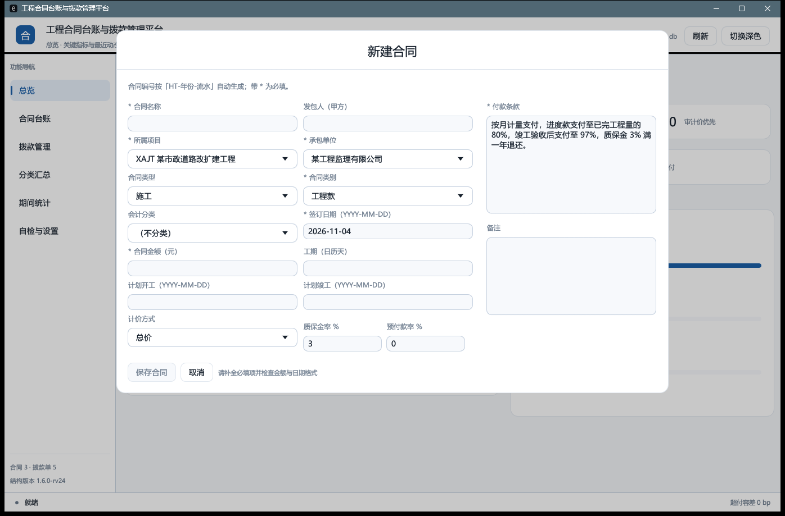

# 工程合同台账与拨款管理平台（本期实现）

依据《工程合同台账与拨款管理平台_软件开发文档_v1.6》与其评审意见
（`工程合同台账与拨款管理平台_软件开发文档_v1.6_评审意见.md`）落地的 Rust 实现。

**本期范围**：合同台账 + 拨款管理 + 四个报表视图 + 口径自检。
**不含**：支付申请、三级审批、红冲、结算、造价指标、RBAC —— 均为评审确认的延期项（见 `docs/口径主表.md` C 节）。

---

## 一、工程结构

```
D:\pay2
├─ Cargo.toml                 工作区
├─ crates/
│  ├─ ctp-core/               领域层（无外部依赖，口径都在这里）
│  │  ├─ money.rs             金额（分，i64）+ 宽容解析 + 财务括号显示 + 打印用固定两位
│  │  ├─ amount_cn.rs         人民币金额转中文大写（零壹贰…圆角分整）
│  │  ├─ rate.rs              比率（万分比）+ Rate::ratio（H1 的唯一实现）
│  │  ├─ contract.rs          合同实体、状态机、有效计价基准、业务字段清单（M1）
│  │  ├─ payment.rs           拨款单实体、PAID/VOID 两态（H5）
│  │  ├─ quota.rs             可付额度、容差、越界级别（BR-01 / BR-15）
│  │  ├─ attachment.rs        四类合同附件（中标通知书/合同/中期结算/审计报告）、50 MB 上限
│  │  ├─ digest.rs            SHA-256 附件指纹（无外部依赖）
│  │  ├─ dict.rs              合同类别 & 会计分类两套字典（H4）
│  │  ├─ date.rs / ids.rs     日期校验、编号生成
│  │  ├─ refs.rs              RV-/RK-/RPT- 前缀规范（M6）
│  │  └─ scope.rs             本期范围台账 + P0 口径校验（M5）
│  ├─ ctp-store/              SQLite
│  │  ├─ schema.rs            建表/索引/视图；已付子查询与比率表达式唯一实现（H1/H2/M3/M4）
│  │  ├─ db.rs                连接、PRAGMA、迁移（含单位角色表重建）、流水号、元数据
│  │  ├─ repo.rs              仓储与视图映射；附件读写；DB-06 结构自检
│  │  └─ seed.rs              基础字典
│  ├─ ctp-app/                应用服务（事务、留痕、额度校验）
│  │  ├─ service.rs           合同登记/生效/作废、金额编辑、审计价、拨款、附件、档案自动建档、报表导出
│  │  ├─ report.rs            ReportResult：屏幕表格 / Excel 导出 / 后期打印共用的唯一数据源
│  │  ├─ xlsx.rs              rust_xlsxwriter 写出（表头 / 冻结 / 合计公式 / #,##0.00）
│  │  ├─ print.rs             付款打印模板描述符 + 9 域字段映射 + PrintAdapter 预留（本轮不产出 docx）
│  │  ├─ checks.rs            六项口径自检（界面「运行自检」的唯一实现）
│  │  ├─ history.rs           金额与审计价变更历史（JSON，保留 50 条）
│  │  └─ tests/consistency.rs 18 项集成断言（评审条目逐条对应）
│  └─ ctp-gui/                egui 桌面界面：六个页面 + 六类弹窗，浅色 / 深色双主题
├─ scripts/                   WSL 构建 / 端到端演练 / 界面截图核验
└─ docs/口径主表.md           金额与比率的单一事实来源
```

技术栈：Rust 1.99（edition 2021）+ rusqlite 0.32（bundled，自带 SQLite，无系统依赖）
+ rust_xlsxwriter 0.102（报表导出）。无 WebView、无前端框架、无 Node
—— 与文档 ADR-06 的技术前提一致。

> **注意**：`rust_xlsxwriter` 是 **write-only**，只能新建 .xlsx，**不能读取或修改已有的 Excel
> 模板**。因此「读取 Excel 模板 → 填充占位符」不可行；打印模板填充走另一条链路
> （Word 邮件合并域），见下文「付款打印模板」与文档 R-25。

**交付形态只有 GUI**：工作区唯一的 bin 是 `ctp-gui`，命令行版本已按要求清理，
不提供也不计划补 CLI。

---

## 二、在 WSL 下编译与运行

工具链已在 WSL Debian 内就绪（`cargo 1.99.1` / `gcc 14.2`）。源码在 `/mnt/d/pay2`，
**target 目录放在 WSL 原生盘**（`$HOME/target-ctp`），避开 9p 挂载的编译慢速问题。

```bash
# 一次性：加入 PATH 并设置 target 目录
export PATH="$HOME/.cargo/bin:$PATH"
export CARGO_TARGET_DIR="$HOME/target-ctp"
cd /mnt/d/pay2

cargo build --workspace          # 编译（首次会编译 bundled SQLite，约 1 分钟）
cargo test  --workspace          # 69 项测试
```

或直接跑现成脚本：

```bash
bash scripts/build_all.sh        # 编译 + 全部测试
bash scripts/e2e.sh              # 端到端演练，结果写 build-log.txt
```

### 运行

```bash
cargo run -p ctp-gui        # 启动图形界面
```

首次启动自动建库并写入基础字典，数据库落在可执行文件同级的 `data/ctp.db`
（开发时即 `target/debug/data/ctp.db`）。总览页的「载入演示数据」可一次生成
2 个项目、3 份合同、5 笔拨款，用来演示四个报表的口径。

界面六个页面：总览、合同台账、拨款管理、分类汇总、期间统计、自检与设置。
自检页的六项与 `ctp_app::checks` 同源：视图比率与应用层一致、DB-06 审计列齐全、
P0 全在本期、外键无悬空、已付口径与「仅 PAID 合计」一致、视图无丢行。

### 新建合同的录入方式

分两步：**基本信息 → 附件**。

- **所属项目 / 承包单位 / 发包人（甲方）** 都是可自由输入的联想框：输入任意片段即浮出
  候选（项目按「编码 + 名称」双匹配），点选即回填；也可以直接输入库里没有的新名称。
- 名称在档案里不存在时**自动建档**：项目编码按 `PRJ-年份-三位流水` 生成；单位按合同类型
  映射角色（施工 / 监理 / 设计 / 勘察 / 供应商），发包人固定记为「业主」。同名复用，不重复建。
- **会计分类**已从表单移除（数据库列保留，新建写空，历史数据的分类汇总不受影响）。
- **四类附件**（中标通知书 / 合同 / 中期结算材料 / 审计报告）分项存储，每类一份，
  重新选择即替换。文件本体以 BLOB 存进 `ct_contract_attachment`，单份上限 50 MB，
  因此整套系统始终只有一个 `ctp.db`，备份不会漏掉附件。
- **合同为正本必传项**，但不是保存时强卡：没有合同附件仍可存为草稿，卡点在「设为生效」。
  这样手里暂时没有电子件时也能先把合同信息录进来。
- 保存后的附件在合同详情卡的「附件 n/4」里管理：打开（落地临时文件后调系统默认程序）、
  另存、替换、删除。

### 报表导出（`rust_xlsxwriter`）

「分类汇总」（V3）与「期间统计」（V4）两页标题右侧各有「导出 Excel」按钮：
弹出保存框 → 生成单页 .xlsx → 写一条 `EXPORT` 审计日志。

- **屏幕表格、柱状图、导出共用同一份 `ReportResult`**（`ctp-app/src/report.rs`），
  列配置驱动，不再各自查库、各自算合计；
- 版式：标题行 + 口径说明行 + 表头行（冻结前三行）+ 数据行 + 合计行；
  金额列写**数值**并套 `#,##0.00`（单位「元」，库内存分），合计用 `SUM` 公式，
  便于在 Excel 里二次筛选计算；页脚注明导出人 / 导出时间 / 系统版本；
- 文件名默认 `{报表名}_{yyyyMMdd_HHmm}.xlsx`。

### 付款打印模板（本期只预留接口，不产出打印件）

实物模板为 `付款打印模板.docx`（Word 邮件合并域 MERGEFIELD，9 个唯一域名 / 11 处，
两张表同在一个文档）。本轮按确认结论**只固化字段映射与数据解析，不生成 docx 文件**：

- 入口：**拨款管理页选中一条付款单 → 「打印」**（拨款明细行内，或拨款单详情弹窗里），
  打开「付款打印数据预览」窗口，逐项列出 9 个域的取值与来源；
- 字段映射（已确认口径）：

  | 合并域 | 取值来源 |
  |---|---|
  | `项目名称` | **合同名称**（不是项目名称） |
  | `中标单位` | **承包单位** |
  | `合同改成元` | 合同价（元、两位小数） |
  | `审计价改成元` | 审计价；**未审定填 0**（输出 `0.00`） |
  | `已付款改成元` | **本次之前**的累计已付 |
  | `本次付款小写` | 本次金额 |
  | `本次付款数大写` | 本次金额 → 中文大写（本期新增能力） |
  | `本次付款后累计` | 已付 + 本次 |
  | `合同约定_付款条件（保持与书面合同一致）` | 付款条款 |

- **留空**：会计分类名、附件张数、当前日期三处无合并域，保持空白供手工填写 / 签字；
  其他字段缺失时也一律留空，不写「—」、不拒绝生成；
- 预留接口：`ctp-app/src/print.rs` 的 `PrintTemplate` 描述符（`FillStrategy`、
  `MissingPolicy`、`OutputScope` 均已固化）+ `PrintAdapter` trait + `PrintContext`
  + 注册表，本轮 `adapters()` 为空实现。后期接 Word 填充只需加一个 adapter，
  业务层与界面不用改；Excel 版模板留作第二个 adapter；
- **实现注意**：模板里 4 个域的 `«…»` 被 Word 拆成 3 个 run，后期填充必须按
  `w:fldChar begin/separate/end` 域边界整体替换为纯文本，纯字符串替换会漏；
- 选型结论：就「填充现成模板」而言 **Word 更容易**（docx 是 zip，只需 `zip` 一个轻量
  依赖、版式 100% 保真）；Excel 真模板必须另引可读写库（`umya-spreadsheet` 等），
  而 `rust_xlsxwriter` 做不到。两条路线与取舍详见开发文档 R-25。

窗口可自由缩放，最小 1000×640；宽度小于 1100px 时左侧导航折叠为缩写并带悬停提示。
右上角可切换浅色 / 深色。

**发布版不带控制台窗口**：`main.rs` 在非 debug 构建里声明了
`windows_subsystem = "windows"`，双击即直接进界面；崩溃信息写到同级的
`data/panic.log`，启动失败写 `data/startup-error.log`（GUI 模式看不到 stderr）。

### 界面自动核验

界面没有控制台输出，因此内置几个环境变量开关（正常启动不生效）：

```powershell
$env:CTP_SELFTEST=1; .\ctp-gui.exe        # 跑 40 帧后退出，写 data/smoke.txt（页名 / 合同数 / 拨款数）
$env:CTP_SHOT="out.ppm"; .\ctp-gui.exe    # 等界面稳定后由渲染器保存一帧，退出码 0
$env:CTP_SCREEN="payments"; $env:CTP_THEME="dark"   # 指定启动页与主题
$env:CTP_DIALOG="new_contract"             # 启动即打开弹窗；另有 attachments / payment_detail / print_preview / audit_price / edit_amount / void_payment
$env:CTP_DIALOG="new_contract"; $env:CTP_STEP="1"   # 直达新建合同的第二步（附件）
$env:CTP_DIALOG="print_preview"            # 启动即预览第一张拨款单的 9 个合并域取值
```

`scripts/gui_probe.py` 在此之上提供截图与点击回放。打印窗口（PrintWindow）对
GPU 呈现的窗口常返回空白，可加 `grab=screen` 改走屏幕直抓。

### 界面预览

| 总览 | 合同台账 |
|---|---|
|  |  |

| 拨款管理 | 期间统计 |
|---|---|
|  |  |

| 深色主题 | 新建合同弹窗 |
|---|---|
|  |  |

---

## 三、评审意见 → 代码落点

| 评审 | 问题 | 代码落点 |
|---|---|---|
| **H1** | V1 比率写成「除后乘 2」，与 V3/Rust 不一致 | `schema::rate_bp_expr` 把 `*2` 放回分母；`Rate::ratio` 为唯一实现；`selfcheck` 与集成测试断言差异为 0 |
| **H2** | 已付取数源三处互斥（分摊表 / 直连 / 混合） | 只保留 `schema::paid_net_subquery` 一处，视 V1～V4 与仓储共用；分摊表本期不建 |
| **H3** | 用例与流程含已移出的申请/审批 | 无 `pay_application` 系列表；`register_payment` 单级登记；合同状态机去掉审批分支 |
| **H4** | `ct_category` 一名两义（合同类别 / 会计分类） | 拆两套字典：合同类别 `sys_dict_item`，会计分类 `ct_category`；`Contract` 同时持两个字段；测试断言编码不重叠。界面已不录入会计分类（列保留、新建写空），历史分类汇总照常可查 |
| **H5** | 红冲「未实现」却又被当作必要条件 | 彻底移除红冲：`status ∈ {PAID, VOID}`、无 `reversal_of`；作废即不计入已付，等价且少一状态机 |
| **M1** | 合同字段数 18/19 不一，`payment_terms` 缺失 | `BUSINESS_FIELDS` 单一清单（25 项，含 `payment_terms`），`business_field_count()` 为唯一计数 |
| **M2** | 已移出模块的残留 | 代码只实现本期模块；`scope::PLAN` 显式登记延期项 |
| **M3** | 建了被否决的索引、`application_id` 悬空外键 | 不建 `ix_contract_audited`；无 `application_id` 列 |
| **M4** | DB-06 要求每表审计列，实际多处缺失 | 业务表全部补齐 5 列，`sys_audit_log` 列入显式豁免；`repo::audit_column_violations` 可执行校验 |
| **M5** | P0 项却在白名单、E-16 优先级两处冲突 | `scope::PLAN` 台账 + `audit_p0_consistency()`：P0 必须在本期，白名单项一律 P1/P2 |
| **M6** | 三套 `R-` 前缀串号 | `refs::RefKind`：只允许 `RV-` / `RK-` / `RPT-`，`R-` 解析直接拒绝 |
| **L1** | 样例数据自相矛盾 | 演示数据只有一套基准（2,850,000 / 118,000 / 500,000），台账、分类、期间三表可互相验算 |
| **L2–L4** | 修订记录顺序、目录写法、视觉色板 | 属文档层面问题，代码不涉及；目录约定已在本文第二节固定为单一写法 |

---

## 四、与文档原稿的有意偏离（均为评审结论）

1. **本期建表 13 张**，而非目标态 21 张：只建被实际读写的表，避免空表带来维护成本。
   （第 13 张是 `ct_contract_attachment`，本期新增的合同附件表。）
2. **`pay_payment.amount_cent > 0`**：作废替代负数红冲，故拨款单恒为正。
3. **合同状态保留 8 个枚举值**以便库内往返，但只有 5 个可流转（`ContractStatus::PHASE_STATUSES`）。
4. **合同编号**沿用「当前实现」口径 `HT-{年}-{三位流水}`，目标态四位流水属二期（4.2.4 已注明需迁移）。

### R-25 三条决策（2026-11-05，正文需求描述未改）

1. **只保留 GUI**：工作区唯一 bin 为 `ctp-gui`，不做、也不再补命令行版本；
2. **去掉「允许未分类暂存于草稿」**：`ct_contract_item.category_id` 保持 `NOT NULL`，
   不重建表、不加迁移；`ct_contract.category_id` 也保持现状（新建合同不录入会计分类，
   写空值），不改表结构；
3. **去掉清单明细**：`ct_contract_item` 不做录入界面 / 命令 / 批量导入 / BR-05 闭合校验。
   **空表与 V3 视图里「按清单行分摊」的分支都保留**（删它们要重建视图、动迁移，收益为零），
   标注为「分支保留但本期无录入入口，恒不命中；未审定合同走 R-20 主导分类整笔归集」。

---

## 五、下一步建议（按投入产出）

1. 接入 Word 打印模板填充 adapter（`zip` 依赖 + 按 `fldChar` 域边界替换 MERGEFIELD），
   把「付款打印数据预览」的按钮接到 `ctp_app::print::render`；Excel 版模板作为第二个 adapter；
2. 合同台账 / 拨款一览两页也接 `ReportResult`，让全部报表统一走列配置驱动；
3. 二期恢复申请与审批时，只需加 4 张预留表并把 `inflight` 从 0 改为两类占用，`PaymentQuota` 无需改动。
