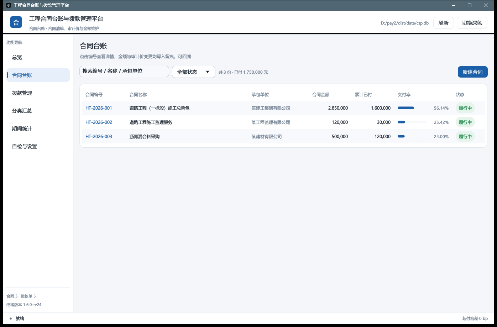
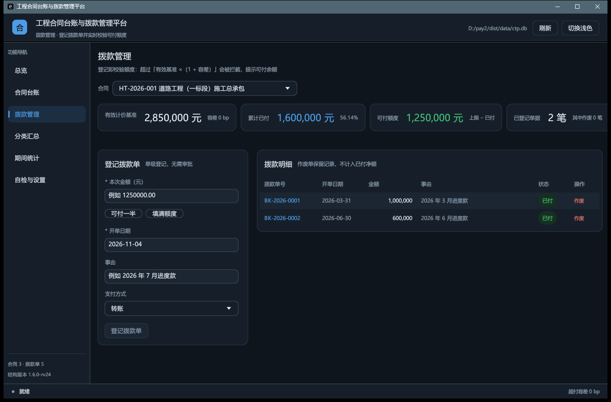

# 工程合同台账与拨款管理平台（本期实现）

依据《工程合同台账与拨款管理平台_软件开发文档_v1.6》与其评审意见
（`工程合同台账与拨款管理平台_软件开发文档_v1.6_评审意见.md`）落地的 Rust 实现。

**程序版本：0.5.8**（对外简称 **0.5.8**；Cargo 要求 `MAJOR.MINOR.PATCH` 三段式，两段 `0.5` 不是合法版本号）。
唯一版本源为根 `Cargo.toml` 的 `workspace.package.version`，四个 crate 均 `version.workspace = true` 继承，
**界面底部状态栏、登录页底部、Excel 导出页脚**三处均由 `env!("CARGO_PKG_VERSION")` 自动取值（零硬编码），显示 `0.5.8`；
界面上的「结构版本」是另一套标签（`1.6.0-rv28`），未改表结构故保持不变。
0.5.8 只改发布流程（R-78）：Release 不再直传未压缩的 exe，只上传
`ctp-gui-<版本>-windows-x64.zip` 与只含该 zip 校验和的 `SHA256SUMS.txt`；程序代码与 0.5.7 一致。
0.5.7 为界面微调（R-77）：拨款管理「拨款明细」改倒序，新登记的拨款单显示在最上面
（开单日期倒序，同日按单号倒序）；Excel「拨款一览」导出与批量打印页序与屏幕一致；无业务口径变化。
0.5.6 为界面微调（R-76）：总览「最近拨款」6 行 → 8 行、合同名称列 ×1.3（其余列整体右移并随表横向滚动）、
拨款页「当前合同为」后追加承包单位、「拨款明细」最大高度与「登记拨款单」卡片对齐；无业务口径变化。
0.5.5 调整付款封顶口径（R-75）：未满足付清条件的累计付款上限由有效计价基准的 80% 改为 **97%**，
其余条件（须已审定、交工满 2 年方可付清、硬上限不叠加容差）不变。

**本期范围**：合同台账 + 拨款管理 + 汇总统计 + 批量拨款导入 + 批量合同导入 + 登录与只读浏览模式 + 操作日志 + 口径自检。
**不含**：支付申请、三级审批、红冲、结算、造价指标、RBAC —— 均为评审确认的延期项（见 `docs/口径主表.md` C 节）。
（R-29 起「用户角色」只分**浏览用户 / 管理员**两级，是身份选择而非 RBAC 账号体系。）

---

## 一、工程结构

```
D:\pay2
├─ Cargo.toml                 工作区
├─ crates/
│  ├─ ctp-core/               领域层（无外部依赖，口径都在这里）
│  │  ├─ money.rs             金额（分，i64）+ 宽容解析 + 财务括号显示 + 打印用固定两位
│  │  ├─ amount_cn.rs         人民币金额转中文大写（零壹贰…圆角分整）
│  │  ├─ rate.rs              比率（万分比）+ Rate::ratio（H1 的唯一实现）
│  │  ├─ contract.rs          合同实体、状态机、有效计价基准、业务字段清单（M1）
│  │  ├─ payment.rs           拨款单实体、PAID/VOID 两态（H5）
│  │  ├─ quota.rs             可付额度、越界级别（R-33 起容差固定 0；BR-01 / BR-15）
│  │  ├─ attachment.rs        四类合同附件（中标通知书/合同/验收材料/审计报告）、50 MB 上限
│  │  ├─ digest.rs            SHA-256 附件指纹（无外部依赖）
│  │  ├─ dict.rs              合同类别 & 会计分类两套字典（H4）
│  │  ├─ date.rs / ids.rs     日期校验、编号生成
│  │  ├─ refs.rs              RV-/RK-/RPT- 前缀规范（M6）
│  │  └─ scope.rs             本期范围台账 + P0 口径校验（M5）
│  ├─ ctp-store/              SQLite
│  │  ├─ schema.rs            建表/索引/视图；已付子查询与比率表达式唯一实现（H1/H2/M3/M4）
│  │  ├─ db.rs                连接、PRAGMA、建库（init_schema，R-69 起无迁移）、流水号、元数据
│  │  ├─ repo.rs              仓储与视图映射；附件读写；DB-06 结构自检
│  │  └─ seed.rs              基础字典
│  ├─ ctp-app/                应用服务（事务、留痕、额度校验）
│  │  ├─ service.rs           合同登记/生效/作废、金额编辑、审计价、拨款、附件、档案自动建档、汇总统计、报表导出
│  │  ├─ logs.rs              操作日志：类型/对象中文映射、查询、一次性清空留痕（R-70）
│  │  ├─ auth.rs              登录与权限：密码加盐 SHA-256、初始密码、校验、改密码、Role（浏览 / 管理）
│  │  ├─ batch.rs             批量拨款：模板导出（含隐藏校验表）+ 逐行导入 / import_key 幂等 + 错误行报告
│  │  ├─ contract_batch.rs    批量合同：21 列空白模板导出（枚举下拉）+ 逐行导入与重复判定（R-55）
│  │  ├─ report.rs            ReportResult：屏幕表格 / Excel 导出 / 后期打印共用的唯一数据源
│  │  ├─ xlsx.rs              rust_xlsxwriter 写出（表头 / 冻结 / 合计数值快照 / #,##0.00）
│  │  ├─ print.rs             9 域描述符与取值解析 → 折成版面字段（Voucher）
│  │  ├─ paper.rs             设备无关版面层：两页横向 A4 的坐标、字体与绘制（出纸与预览共用）
│  │  ├─ gdi.rs               打印后端（仅 Windows）：PrintDlgW + StartDocW 出纸 / 内存 DIB 预览
│  │  ├─ checks.rs            六项口径自检（界面「运行自检」的唯一实现）
│  │  └─ tests/consistency.rs 集成断言（口径 / 端到端 / 打印；R-69 起无旧库形态用例）
│  └─ ctp-gui/                egui 桌面界面：登录页 + 六个页面 + 六类弹窗，浅色 / 深色双主题
├─ scripts/                   WSL 构建 / 端到端演练 / 界面截图核验
└─ docs/口径主表.md           金额与比率的单一事实来源
```

技术栈：Rust 1.99（edition 2021）+ rusqlite 0.32（bundled，自带 SQLite，无系统依赖）
+ rust_xlsxwriter 0.102（报表导出）+ windows-sys 0.59 / raw-window-handle 0.6（打印，仅 Windows）。
无 WebView、无前端框架、无 Node，打印也不依赖任何办公软件 —— 与文档 ADR-06 的技术前提一致。

> **注意**：`rust_xlsxwriter` 是 **write-only**，只能新建 .xlsx，**不能读取或修改已有的 Excel
> 模板**。因此「读取 Excel 模板 → 填充占位符」不可行。打印件则完全不走模板文件：
> 版面写在 `paper.rs` 里、用 GDI 直接画到打印机，见下文「付款打印」与文档 R-28。

**交付形态只有 GUI**：工作区唯一的 bin 是 `ctp-gui`，命令行版本已按要求清理，
不提供也不计划补 CLI。

---

## 二、在 WSL 下编译与运行

工具链已在 WSL Debian 内就绪（`cargo 1.99.1` / `gcc 14.2`）。源码在 `/mnt/d/pay2`，
**target 目录放在 WSL 原生盘**（`$HOME/target-ctp`），避开 9p 挂载的编译慢速问题。

```bash
# 一次性：加入 PATH 并设置 target 目录
export PATH="$HOME/.cargo/bin:$PATH"
export CARGO_TARGET_DIR="$HOME/target-ctp"
cd /mnt/d/pay2

cargo build --workspace          # 编译（首次会编译 bundled SQLite，约 1 分钟）
cargo test  --workspace          # 226 项测试（2 项 ignored 需人工核对）
```

或直接跑现成脚本：

```bash
bash scripts/build_all.sh        # 编译 + 全部测试
bash scripts/e2e.sh              # 端到端演练，结果写 build-log.txt
```

### 运行

```bash
cargo run -p ctp-gui        # 启动图形界面
```

首次启动自动建库并写入基础字典，数据库落在可执行文件同级的 `data/ctp.db`
（开发时即 `target/debug/data/ctp.db`）。空库时总览页只给「新建合同」一个入口，
不再内置任何演示数据；需要试跑口径，用「导出批量合同模板 → 填好 → 导入」自行造数。

界面六个页面：总览、合同台账、拨款管理、汇总统计、操作日志、自检与设置（启动先过登录页）。
自检页的六项与 `ctp_app::checks` 同源：视图比率与应用层一致、DB-06 审计列齐全、
P0 全在本期、外键无悬空、已付口径与「仅 PAID 合计」一致、视图无丢行。

### 登录与权限（R-29）

启动先进登录页，两个按钮：

- **浏览登录** —— 免密进入，**只读**：全部页面和弹窗都能看、能导出，但任何写操作都会弹「无权限」；
  导航里不出现「自检与设置」与「操作日志」；
- **管理登录** —— 展开密码框，**初始密码 `0001`**，改密码在「自检与设置 → 管理密码」（需验旧密码，新密码 4–20 位）。

实现要点：

- 写权限收敛在 `App::exec()` 一个点上判（`can_write()`），不会漏埋；只读走 `App::read()`，不受权限影响；
- 按钮**不置灰**，按用户口径「点了才提示无权限」；入口处用 `require_write()` 提前挡，避免填完表单才发现存不进；
- 密码以 `sha256(盐 + 明文)` 存 `sys_meta` 的 `auth.admin_password`（盐前缀 `ctp-admin-v1:`），**库里不存明文**；
- **不跨重启保持**：登录状态只在内存，关掉程序即失效；
- **原有数据零影响**：不新增表、不改表结构、不加列；首次启动检测到没密码才写初始值，已有密码不覆盖。

### 批量导入拨款（R-29）

「拨款管理」页头两个按钮：

1. **导出批量拨款模板** —— 从库里读全部合同生成 `.xlsx`：前 5 列（合同名称 / 承包单位 / 合同价 /
   审计价 / 累计已付）预填，只供核对；后 4 列（本次金额 / 开单日期 / 事由 / 支付方式）待填；
2. **导入批量拨款** —— 读回填好的表，逐行校验后登记。

防错设计：

- 模板里内嵌一张**隐藏工作表 `_CTP_CHECK`**，A1 写 `CTP-BATCH-PAYMENT-V1`；导入时做三重检查
  （表在不在 → 标记读不读得出 → 标记等不等），任一不过**整份拒绝**，避免「拿别的表改改列名」导致列错位写坏账；
- 前 5 列**不采信**，一律以库内为准；合同按**名称严格匹配**，同名多份直接报「对应 N 份，无法确定」；
- **逐行跳过**：某行不合格只跳过该行，最后弹「成功 N 行 / 失败 M 行」并逐条列出**行号 + 原因**；
  「本次金额」空着的行视为不导入，不算失败（模板预填了全部合同，只填几行是正常用法）。

### 批量导入合同（R-55）

「合同台账」页头新增两个按钮（在「新建合同」左侧紧邻）：

1. **导出批量合同模板** —— 生成**空白** `.xlsx`：`21 列 = 「新建合同」表单的全部字段`
   （名称 / 甲方 / 项目 / 承包单位 / 负责人 / 联系方式 / 招标方式 / 开标时间 / 招标代理 / 计划开工 /
   工期 / 计划交工 / 合同类型 / 合同类别 / 签订日期 / 合同金额 / 计价方式 / 质保金率 / 交工日期 / 付款条款 / 备注）；
   必填列浅黄表头 + `*`，枚举列（类型 / 类别 / 计价 / 招标）带下拉，日期列强制文本格式；
2. **批量导入合同** —— 读回填好的表，逐行建档。

口径：

- **不含**合同编号（按 `HT-年份-流水` 自动生成）、审计价四列（走「登记审计价」留痕）、状态、实际开竣工；
- 模板同样内嵌隐藏工作表 `_CTP_CHECK`，但标记是 `CTP-BATCH-CONTRACT-V1` —— 两种模板**互相导入必被挡**；
- 项目 / 承包单位 / 甲方 / 招标代理**填名称即可**，查不到自动建档（与新建表单同一条解析路径）；
- 导入后**一律草稿**：`activate_contract` 要求先有合同附件，Excel 带不了附件，生效仍在界面里做；
- **查重**：同名 + 同承包单位已存在 → 该行失败，同一张表误传两次不会翻倍；
- 计划交工留空时按「计划开工 + 工期（含开工当日）」推算，与新建页同一函数；整行空白不计入统计。

### 汇总统计（R-32，取代原「分类汇总」+「期间统计」）

一个页面解决四个维度：**按项目 / 按承包单位 / 按合同 / 按合同类型**（按日维度已删）。

- 统计区间按**日**填（`YYYY-MM-DD` 闭区间，**留空 = 不限**），另有「本月 / 本年 / 全部时间」快捷链接；
- **筛选**：项目状态（履行中 / 归档关闭，归档口径 = 全周期支付率 ≥ 100%）、
  合同类型（工程 / 货物 / 服务）、关键词（项目 / 承包单位 / 合同）；
- 四个维度**共用同一段 WHERE**（`status='PAID' AND is_deleted=0` + 区间 + 筛选），
  只换 `GROUP BY` 键，因此**切换维度后合计不变**（集成测试逐维度断言）；
- **按合同**只列区间内有拨款的合同，表格单独多一列承包单位；
- 行数 ≤ 31 时画柱状图，超过只留表格；表格含「占合计」列；
- 右上「导出 Excel」，与屏幕共用同一份 `ReportResult`，副标题写明区间与筛选条件。

### 操作日志（R-31，仅管理员可见）

所有写库操作的留痕集中在一页：时间（本地时区）/ 操作类型 / 对象类型 / 操作对象 / 操作内容 / 操作人。

- **操作人 = 当前登录身份**（管理员 / 浏览用户），由 `App::operator()` 单一来源提供；
  R-57 之前各处硬编码，日志里同一个人会显示成「界面用户」与「管理员」两个名字；
- 复用 `sys_audit_log` 追加一列 `target_label` 存对象可读名称，旧库自动补列、历史日志不丢；
- 埋点覆盖：合同登记/生效/作废、金额编辑、审计价、交工日期、拨款登记/作废、附件增删、
  报表导出、批量导入，以及**管理登录成败、改管理密码**（R-33 起容差固定 0，不再有改容差动作）；
- 筛选：日期区间 + 操作类型 + 关键词；单页最多显示 500 条，超出显示「共 N 条」；
- 清理：**R-70 起只保留「清理日志」一条入口**（按时间段 / 按条件清理已移除）：二次确认 + 输入「清空」，
  保底保留最近 200 条，清完留一条 `CLEAR` 记录写明条数。日期区间仍用于**列表筛选**，但不再是清理范围；
- 容量：超 5 万条自动裁掉最旧的（裁剪本身不写日志，防自我循环）。

### 新建合同的录入方式

分两步：**基本信息 → 附件**。

- **所属项目 / 承包单位 / 发包人（甲方）** 都是可自由输入的联想框：输入任意片段即浮出
  候选（项目按「编码 + 名称」双匹配），点选即回填；也可以直接输入库里没有的新名称。
- 名称在档案里不存在时**自动建档**：项目编码按 `PRJ-年份-三位流水` 生成；单位按合同类型
  映射角色（工程 → 施工、货物 → 供应、服务 → 其他），发包人固定记为「业主」。同名复用，不重复建。
  （单位档案自身的角色字典仍是 施工 / 监理 / 设计 / 勘察 / 供应 / 业主 / 其他 / 代理 八类，
  供历史数据与手工建档使用，不随合同类型一起收窄。）
- **会计分类**已从表单移除（数据库列保留，新建写空，历史数据的分类汇总不受影响）。
- **四类附件**（中标通知书 / 合同 / 验收材料 / 审计报告）分项存储，每类一份，
  重新选择即替换。文件本体以 BLOB 存进 `ct_contract_attachment`，单份上限 50 MB，
  因此整套系统始终只有一个 `ctp.db`，备份不会漏掉附件。
- **合同为正本必传项**，但不是保存时强卡：没有合同附件仍可存为草稿，卡点在「设为生效」。
  这样手里暂时没有电子件时也能先把合同信息录进来。
- 保存后的附件在合同详情卡的「附件 n/4」里管理：打开（落地临时文件后调系统默认程序）、
  另存、替换、删除。

### 报表导出（`rust_xlsxwriter`）

「汇总统计」「合同台账」「拨款管理（拨款一览）」三页各有「导出 Excel」按钮：
弹出保存框 → 生成单页 .xlsx → 写一条 `EXPORT` 审计日志。

- **屏幕表格、柱状图、导出共用同一份 `ReportResult`**（`ctp-app/src/report.rs`），
  列配置驱动，不再各自查库、各自算合计；
  R-33 起**合同台账与拨款一览也接入同一套结果对象**：表头 / 单元格 / 合计行由
  `columns / rows / totals` 驱动，勾选、链接、徽标等交互列仍由页面绘制；
  合同台账窄屏降列只改变结果里的可见列；**R-46 起导出前可选列**（默认全选 9 列、可调整顺序），
  Excel 只写所选字段，数据仍取当前列表筛选 / 排序后的结果；拨款一览导出额外带
  「合同名称」「承包单位」两列（按 `contract_id` 关联，查不到留空），屏幕明细表仍是 5 列；
  **R-50 起新建合同填完「工期 + 计划开工」自动算「计划交工」**（含开工当日，即开工 + 工期 − 1 天），
  手改交工日后停止同步并在字段下方提示；
- **R-50 起合同台账详情卡新增「信息修改」**（与附件 / 审计价 / 交工 / 去拨款同一行，仅可写身份可见）：
  只改主档字段（名称、单位、项目、类型类别、日期、工期、条款、备注等），编号 / 金额 / 审计价 / 状态 / 交工日期
  仍走各自入口；保存必须填「修改原因」，写 `EDIT_CONTRACT` 审计并记字段级 diff，无改动直接拒绝；
  **R-51 起保存成功改为弹窗**逐行列出「字段 / 修改前 / 修改后」（长文本显示全文，审计仍只记「已修改」）；
- **R-51 起所属项目只按名称显示与解析**（修改窗里不再带项目编码，联想候选仍可按编码检索，
  点选只回填名称）；`编码 名称` 混写时名称优先，旧编码不会把改过的名称吞掉，改项目后可正常保存；
- **R-59 起台账点「承包单位」展开该单位的其他合同**：在该行下方展开一张子表
  （合同编号 / 合同名称 / 合同金额 / 审计价 / 支付率 / 项目状态），数据取全量台账、
  不受搜索与状态筛选影响，并排除当前行；点名称打开合同详情。
  **R-63 起标题份数与合计金额都含本合同**：标题为「承包单位合同 · N 份」（N = 其他合同数 + 1，
  即该单位在库里的全部合同数），右侧「合计合同金额」= **本合同金额 + 其他合同金额之和**；
  没有其他合同时合计退化为本合同金额、不再整块隐藏。表格本身仍只列其他合同（不插入本合同行），
  因此表内各行金额相加会小于合计，差值正是本合同金额。
  **R-60 起两个展开入口的逻辑完全统一**：都按行 id 记状态、都带 ＋/－ 标记、展开时文字转主色、
  再点一次收起；与「展开拨款明细」**互斥**（同一时刻只开一个面板，点空白处收起）；
  窄屏降列后没有承包单位列，该入口随之不可用；
- **R-60 起台账三个入口重新分工**：① 点**合同名称** → 选中该行并打开只读详情弹窗；
  ② 点**累计已付**金额 → 展开 / 收起该合同的拨款明细（＋/－ 标记已从名称移到金额左侧）；
  ③ 点**承包单位** → 展开该单位的其他合同；三处入口都会把右侧栏切到该行
  （R-59 当初不给承包单位做选中，是因为选中会拉出详情卡、台账降列后面板看不成；
  R-66 起侧栏常驻且宽度恒定，这条顾虑不再成立）。**合同编号不再有任何点击交互**，
  文字改回常规色，只在选中行加粗+下划线；单位面板内的编号同样不可点；
- **R-61 起展开 / 收起的判定改到「释放」帧、状态转移放到帧末**：原先在帧首就收起，
  按下那一帧的表格已经少掉一个面板的高度，跨滚动区切换目标时会错位、点击被判成拖拽而失效；
  现在按下帧不动布局，收起与展开同一帧末算清，无中间态。切换目标时用「面板高度预修正 +
  行位置落位」让被点的那一行停在原屏幕位置，内容不跟着跳；两处入口共用同一条路径；
- **R-62 起点开后会把展开的内容滚进可视区**：原先只做「让被点行停在原处」，行落在视口下半部时
  面板整块长在视口之外，要手动下滚才看得到。现在按「最小滚动」落位——放得下就保持原地不动，
  面板越出下边界就把内容上推刚好放下，块比视口还高则让该行贴顶、面板自上而下展示；
  补偿在面板画完之后施加（面板内表格自带的滚动区会吞掉本帧的滚动指令），已完全可见时零位移；
- **R-64 起四个数值列表头可点击排序**：合同金额 / 审计价 / 累计已付 / 支付率。
  首次点击某列按**倒序**（金额大的在前，表头显示 ↓），再点同一列切换为正序（↑）；
  换一列时旧列的方向被覆盖、新列重新从倒序开始——任一时刻只有一列参与排序，其余列没有箭头。
  排序落在 `filtered_summaries()` 里，屏幕表格、底部合计行与 Excel 导出共用同一份行序。
  **审计价未审计（显示「—」）不论正序倒序都排在末尾**；等值行保持筛选原序（稳定排序）。
  排序一变行序整体重排，列表回到顶部；展开面板按行 id 记状态，跟着它那一行走。
  窄屏降列后合同金额 / 审计价两列不显示，这两列的排序入口也随之消失，但排序状态保留，
  恢复列宽后箭头与行序照旧；
- **R-65 起表头的点击区域只认文字本身**：原先点击落在 label 与外层格子的叠层上，
  可选中文本的 label 带 `click_and_drag` 语义会抢走点按，导致「只有文字旁边的空白能排序」，
  且右对齐列（金额类）在左、左对齐的支付率列在右；现在表头 label 一律 `selectable(false)`，
  再按文字矩形单独注册一次点击，五列一致；
- **R-65 起点「合同编号」表头恢复初始排序**：初始排序 = 库返回的原始行序。
  排序生效时该列标题转正文色并带「↺」，点击即清空排序并回到列表顶部；
  本就没有排序时点击是空操作（既不重排也不跳顶部），标题保持灰字；
- **R-66 起右侧栏常驻、点行内任意位置切换焦点**：侧栏不再是「选中了才出现」，
  只要窗口 ≥920（足够放下侧栏 + 5 列）就一直占 344px；进页面时焦点默认落在当前列表首行，
  保证打开就能看到一份合同。点行内**任意位置**都会把侧栏切到该行——包括点在合同编号、
  项目状态、支付率条这些纯展示格上；而行内的三个字段入口（名称 / 累计已付 / 承包单位）
  仍然优先截获自己那一小块点击，做原有动作（弹窗 / 展开明细 / 展开单位合同）**并同步切焦点**，
  互不冲突。因为侧栏宽度恒定，选中与切换焦点不再改变表格宽度，也就不会触发降列、不会让展开面板消失。
- **R-67 起「登记审计价」再次打开时五项整表回填**：金额、审定日期、审定单位、审定报告号、
  变更原因都取库里现值（原因取该合同最近一条 `SET_AUDIT_PRICE` 日志）。此前只回填金额，
  日期退回今天、单位与报告号为空，而提交是无条件覆盖写 —— 点一次「确认登记」就会把
  原有的审定单位与报告号清空、日期改成当天。弹窗现在锁定表单所属合同（`audit_target`），
  期间点别的行会按新合同重填、提交只写给那一份，不会出现「填的是 A、写给了 B」；
- **R-67 起附件替换 / 删除会真正回收空间**：SQLite 的 `ON CONFLICT DO UPDATE` 只把旧 BLOB
  占的页挂回 freelist，文件高水位不回落（10 MB 换成 1 MB，库仍是 10 MB），旧内容还会以明文
  留在空闲页里。现在「换成更小的文件」或「删除附件」之后执行 `VACUUM` + WAL checkpoint
  （漏了 checkpoint 主库文件不会变小），并在打开连接时开启 `secure_delete`。
  记录层面本来就干净：每类附件只有一行，替换是覆盖而不是新增。
  侧栏内容相应删掉了「合同类型 / 开标时间 / 招标代理」三行（这些字段在合同信息修改与详情弹窗里仍可见）；
  列表为空时侧栏显示「未选择合同」占位，不再整块消失；
- **R-70 起全库写入路径复查、日志精简，版本 0.5.0**：
  新建合同 + N 个附件 + 立即生效收进 `create_contract_bundle` 单个 IMMEDIATE 事务，任一步失败整体回滚
  （此前合同 / 部分附件 / CREATE 日志会先落库，界面却报「新建合同失败」），组合路径同样执行附件名净化与空文件 / 超上限校验；
  导出改走具名门面 `App::export_audit`（只允许写 `sys_audit_log`，不碰业务表），`CTP_ROLE` 跳过登录仅限 `CTP_SELFTEST=1`；
  基础字典重复 seed 不再覆盖已改过的名称，批量拨款查重不再吞 DB 错误，可选文本 / 日期统一归一（空串写 NULL），
  `Payment::validate` 拒绝空串 / 控制字符 / 超长文本，关联档案 id 显式校验，`init_schema` 改用 IMMEDIATE 事务，
  合同类别校验提示补全 `SJ`；未知招标方式原码写库时归一为 NULL 并把原码记进审计留痕（解除「含未知码合同编辑必失败」），
  首笔状态迁移与作废回退改用 `PERFORMING` / `REVERT_ACTIVE` 独立动作码，表单非法工期 / 质保金比例改为显式报错。
  操作日志移除按时间段 / 按条件清理的入口、参数、界面控件与处理逻辑，只保留一次性清空
  （按钮文案「全部清理」→「清理日志」），确认词、保底 200 条、二次确认、清完留 `CLEAR` 均不变。
  全量 **234 passed / 2 ignored / 0 failed**，四项门禁全 0。
- **R-69 起移除迁移功能与旧版历史数据，并把报表 / 导入 / 日志口径一次性对齐**（软件尚未正式投用，
  库内均为演示数据，允许破坏性变更；8 项确认全部按推荐）：
  `migrate()` 改为幂等的 `init_schema()`——只建表 / 索引 / 视图，不删不改已有数据；
  版本守卫、老库 CHECK 重建、补列 / 删列、枚举改写、同名单位去重、序号校准、旧日志迁入等兼容分支全部删除，
  `SCHEMA_VERSION` 退为仅供顶栏与自检页显示的编译期标签，库内不再写 `schema_version` / `tol_bp`。
  `ctp-app/src/history.rs` 与 `sys_meta` 里两个全局 JSON 历史键整体移除；
  `ct_contract_change_history` / `sys_audit_log` / `sys_meta`（登录密码摘要）保留，审计链不断。
  数据准确性修复：按项目汇总的项目名与关键词统一关联 `c.project_id`（此前分组用当前项目、名称却用签约快照）；
  xlsx 合计行改写死数值快照（SUM 公式在 Excel 里重算会把已剔除的作废行加回来）；
  日志清理保底改按「删完还剩多少」判定、关键词按字面转义，`%` 不再能绕过保底；
  批量拨款加行级 `import_key` 幂等键与唯一索引，同一张表重传不会重复入账；
  批次审计日志改 `IMPORT_START` / `IMPORT_DONE` 双事件、批次号前置、写失败作为可见警告返回界面；
  `update_payment` 补实体校验，`Contract::validate` 补开标日期与未知招标方式，附件名净化掉路径与保留字符。
  演示库先备份并验证可读（`integrity_check=ok`）再清空，程序下次启动自动建空库。
  全量 **226 passed / 2 ignored / 0 failed**，四项门禁全 0，版本 **0.4.12**。
- **R-68 起数据写入路径补齐安全边界**（全库 24 个风险点逐项修复 + 24 项回归测试）：
  编辑合同金额不得低于「累计已付 / 审计价」的较大者（低于已付会让支付率倒挂、该合同此后再也付不出款）；
  作废合同一律拒绝改金额 / 审计价 / 交工日期；合同类型决定 97% 封顶与付清条件，变更需二次确认；
  批量合同导入的浮点 / 整数 / 文本三种单元格统一受单笔金额上限约束；
  附件替换的审计日志改记 upsert 后的真实 id（此前指向不存在的新 id）。
  落盘从 WAL + `synchronous=NORMAL` 升为 `FULL`（掉电不丢已提交事务），业务默认日期统一按东八区；
  流水号撞号自动重取；变更历史改用带 `contract_id` 的独立表，
  不再挤全局 50 条上限的 JSON 数组；单位名加部分唯一索引；
  拨款归集改按合同当前项目；台账合计排除作废合同并在屏幕 / 导出双处标注；
  导出 xlsx 先写临时文件再原子改名；操作日志「全部清理」至少保留最近 200 条且需输入确认词；
  作废最后一笔已付后合同状态回退「生效」；移除恒为 0 的 `print_count` 列。
  全量 **225 passed / 2 ignored / 0 failed**，四项门禁全 0，版本 **0.4.11**。
- **R-52 起把「同一字段多种写法」和「重复提交仍留痕」一并收口**：
  1）付款页合同输入框必须与选中合同一一对应，打错 / 清空 / 命中多份时显示「未匹配」并禁用登记，
  不再静默沿用上一份合同（防串账）；2）编辑金额、登记审计价、登记交工日期先判同值，
  无变化时提示「没有修改任何内容」，不写历史也不写日志，更不顶「口径违例」；
  3）修改成功弹窗的质保金率改读百分数（`3.00%`，与表单、详情卡同口径）；
  4）承包单位 / 发包人写成「编码 名称」时按名称段认领档案，不再建出带编号的重复单位；
  5）档案查不到时统一显示「—」，报表不再回退成主键或空串；
- **R-53 起拨款页合同改为「可搜索下拉」**（R-52 第 1 条的输入框方案由它取代）：
  选项覆盖全部未删除合同（按编号升序），空筛选即全量列出、限高滚动，超过 200 条提示继续输入；
  点选即按合同 id 绑定，`pay_contract` 是唯一真值——不再有「输入文字与选中合同不一致」的中间态，
  因此 R-52 的「未匹配红标 + 禁用登记」整体退场；同名合同在右侧补承包单位区分；
  选中合同不在当前清单时清空选择，登记处再兜底挡一次；
- **R-54 起下拉只认名称**：选项与收起态按钮都不再显示合同编号，筛选也只按合同名称匹配
  （空格分词、多词 AND）——看得见什么就能搜什么；
  弹层宽度按本屏最长的名称自适应撑开（上限为窗口可用宽度），名称**默认完整可见**；
  达到上限仍未放下时，鼠标悬停该行按住 **Shift + 滚轮**左右滚动查看，右侧 `›` 提示还有内容；
  收起态按钮宽度保持 372（不挤动右侧状态徽标与支付率条），超宽时同样支持 Shift+滚轮并给悬停提示；
- 版式：标题行 + 口径说明行 + 表头行（冻结前三行）+ 数据行 + 合计行；
  金额列写**数值**并套 `#,##0.00`（单位「元」，库内存分），合计用 `SUM` 公式，
  便于在 Excel 里二次筛选计算；页脚注明导出人 / 导出时间 / 系统版本；
- 文件名默认 `{报表名}_{yyyyMMdd_HHmm}.xlsx`。

### 付款打印（不依赖任何外部软件）

打印由程序自己排版、自己画到打印机：**不经过 Word / Edge / PDF 阅读器**，也不需要本机装任何办公软件。

- 入口三处，共用一套逻辑：总览「最近拨款」行内文字链、合同台账展开明细行内、拨款管理明细行内；
- 点开后是**核对窗**：左侧真实位图预览（可翻页），右侧 9 个域的取值与来源；
  点「打印」直接弹 Windows 系统打印对话框出纸；
- **结果反馈（R-42 / R-44）**：成功（作业提交打印队列）弹「打印已提交」卡片，列出打印件名 / 单据张数 / 输出页数 / 提交时间，
  5 秒自动关闭、可提前「关闭」；失败弹「打印失败」卡片（原因 + 建议操作 + 技术信息，仅手动关闭）；用户取消不弹提示。
  两态互斥、失败优先，均为叠加层，关闭后预览数据原样保留；`EndDoc` 成功不等于纸张物理出完，文案不写「已完成」。
  前置校验仍走底部提示条，其他模块提示条不变；
- 版面：两页横向 A4 —— 第 1 页「财务支出审核监督表」、第 2 页「工程项目进度款支付申请表」，
  坐标从实物模板 PDF 逐线量取（`paper.rs` 的 `S1_ROWS` / `S2_COLS` 等常量）；
- **字体按模板逐项对齐（R-29）**：第 1 页正文新宋体 14.5pt（部门行 16.5pt、年月日 14.5pt），
  第 2 页正文宋体 11pt（「审计价」「合同履行情况」两格 10pt），两页标题走模板「标题 1」样式 =
  **新宋体 21.5pt 加粗**。取值全部来自模板 `document.xml` 的 `w:sz` / `w:rFonts` 与 `styles.xml`，
  不是估计值；同时保留「按格宽格高自动降字号」兜底，**不溢出优先**；
- 批量：仅拨款单，明细里勾选若干条 → 「批量打印所选」，合并成一份、**每张两页**；
- 作废单不允许打印（入口不出现 + 生成前校验双保险），也不可勾选；
- **纸型必须 A4 横向**：A4 纵向会裁掉右半边，程序取到打印机后立刻拦下并提示改纸型，不静默打半张；
- 字段映射（口径与模板一致）：

  | 域 | 取值来源 | 落在版面哪里 |
  |---|---|---|
  | 项目名称 | **合同名称**（不是项目名称） | 第 1 页支付用途说明 + 第 2 页项目名称 |
  | 中标单位 | **承包单位** | 第 2 页施工单位 |
  | 合同改成元 | 合同价（元、两位小数） | 第 2 页合同价 |
  | 审计价改成元 | 审计价；**未审定填 0**（输出 `0.00`） | 第 2 页审计价 |
  | 已付款改成元 | **本次之前**的累计已付（按开单日期、排除作废） | 第 2 页目前已累计支付金额 |
  | 本次付款小写 | 本次金额 | 第 1 页小写 + 第 2 页本期申请支付金额 |
  | 本次付款数大写 | 本次金额 → 人民币中文大写 | 第 1 页大写 |
  | 本次付款后累计 | 已付 + 本次 | 第 2 页本期末累计支付金额 |
  | 合同约定_付款条件 | 付款条款 | 第 2 页合同履行情况 |

- **留空**：会计分类名、附件张数、当前日期三处保持空白供手工填写 / 签字；
  其他字段缺失时也一律留空，不写「—」；
- 实现分两层：
  - `ctp-app/src/paper.rs` —— 设备无关版面层。`Canvas` trait（`line` / `rect` / `draw_text` /
    `measure_text`，mm 坐标）是唯一绘图接口，`paint()` 是唯一排版入口。**出纸与预览共用这一份代码**，
    所以预览图就是成品；
  - `ctp-app/src/gdi.rs`（`#[cfg(windows)]`）—— 两个后端。`print_vouchers` 走
    `PrintDlgW`（弹系统打印对话框取 DC）+ `StartDocW` / `StartPage` / `EndPage` / `EndDoc`（多页作业）；
    `render_page` 走 `CreateDIBSection` 渲染到内存供界面预览。两者只差坐标缩放。
- **工程坑（`windows-sys 0.59`）**：`StartDocW` / `StartPage` / `EndPage` / `EndDoc` / `DOCINFOW`
  定义在 `Win32::Storage::Xps`（不是 `Win32::Graphics::Printing`），要开 `Win32_Storage_Xps` feature；
  `RECT` 在 `Win32::Foundation`。`CreateFontW` 用负高度表示字符高度，pt→px 为 `dpi × 25.4 / 72`。
  内存 DIB 的 BGRA→RGBA 必须在 `DeleteObject(dib)` **之前**拷完，否则读已释放内存会直接崩
  （`STATUS_ACCESS_VIOLATION`）。
- 打印附件另走一条：按原件交给系统默认程序打开，由用户自己选打印范围，程序不接管、不合并、不批量。

窗口可自由缩放，最小 1100×720；宽度小于 1100px 时左侧导航折叠为缩写并带悬停提示。
右上角可切换浅色 / 深色，右侧另有身份徽标与「退出」。

**发布版不带控制台窗口**：`main.rs` 在非 debug 构建里声明了
`windows_subsystem = "windows"`，双击即直接进界面；崩溃信息写到同级的
`data/panic.log`，启动失败写 `data/startup-error.log`（GUI 模式看不到 stderr）。

### 界面自动核验

界面没有控制台输出，因此内置几个环境变量开关（正常启动不生效）：

```powershell
$env:CTP_SELFTEST=1; .\ctp-gui.exe        # 跑 40 帧后退出，写 data/smoke.txt（页名 / 合同数 / 拨款数）
$env:CTP_SHOT="out.ppm"; .\ctp-gui.exe    # 等界面稳定后由渲染器保存一帧，退出码 0
$env:CTP_SCREEN="payments"; $env:CTP_THEME="dark"   # 指定启动页与主题
$env:CTP_DIALOG="new_contract"             # 启动即打开弹窗；另有 attachments / payment_detail / print_preview / print_batch / material_print / audit_price / edit_amount / void_payment / contract_detail
$env:CTP_DIALOG="new_contract"; $env:CTP_STEP="1"   # 直达新建合同的第二步（附件）
$env:CTP_DIALOG="print_preview"            # 启动即打开打印核对窗（真实位图预览 + 九域取值）
```

`scripts/gui_probe.py` 在此之上提供截图与点击回放。打印窗口（PrintWindow）对
GPU 呈现的窗口常返回空白，可加 `grab=screen` 改走屏幕直抓。

### 界面预览

| 总览 | 合同台账 |
|---|---|
|  |  |

| 拨款管理 | 汇总统计 |
|---|---|
|  |  |

| 深色主题 | 新建合同弹窗 |
|---|---|
|  |  |

---

## 三、评审意见 → 代码落点

| 评审 | 问题 | 代码落点 |
|---|---|---|
| **H1** | V1 比率写成「除后乘 2」，与 V3/Rust 不一致 | `schema::rate_bp_expr` 把 `*2` 放回分母；`Rate::ratio` 为唯一实现；`selfcheck` 与集成测试断言差异为 0 |
| **H2** | 已付取数源三处互斥（分摊表 / 直连 / 混合） | 只保留 `schema::paid_net_subquery` 一处，视 V1～V4 与仓储共用；分摊表本期不建 |
| **H3** | 用例与流程含已移出的申请/审批 | 无 `pay_application` 系列表；`register_payment` 单级登记；合同状态机去掉审批分支 |
| **H4** | `ct_category` 一名两义（合同类别 / 会计分类） | 拆两套字典：合同类别 `sys_dict_item`，会计分类 `ct_category`；`Contract` 同时持两个字段；测试断言编码不重叠。界面已不录入会计分类（列保留、新建写空），历史分类汇总照常可查 |
| **H5** | 红冲「未实现」却又被当作必要条件 | 彻底移除红冲：`status ∈ {PAID, VOID}`、无 `reversal_of`；作废即不计入已付，等价且少一状态机 |
| **M1** | 合同字段数 18/19 不一，`payment_terms` 缺失 | `BUSINESS_FIELDS` 单一清单（25 项，含 `payment_terms`），`business_field_count()` 为唯一计数 |
| **M2** | 已移出模块的残留 | 代码只实现本期模块；`scope::PLAN` 显式登记延期项 |
| **M3** | 建了被否决的索引、`application_id` 悬空外键 | 不建 `ix_contract_audited`；无 `application_id` 列 |
| **M4** | DB-06 要求每表审计列，实际多处缺失 | 业务表全部补齐 5 列，`sys_audit_log` 列入显式豁免；`repo::audit_column_violations` 可执行校验 |
| **M5** | P0 项却在白名单、E-16 优先级两处冲突 | `scope::PLAN` 台账 + `audit_p0_consistency()`：P0 必须在本期，白名单项一律 P1/P2 |
| **M6** | 三套 `R-` 前缀串号 | `refs::RefKind`：只允许 `RV-` / `RK-` / `RPT-`，`R-` 解析直接拒绝 |
| **L1** | 样例数据自相矛盾 | 测试夹具只有一套基准（2,850,000 / 118,000 / 500,000），台账、分类、期间三表可互相验算；R-58 起该夹具仅供测试，产品不再内置演示数据 |
| **L2–L4** | 修订记录顺序、目录写法、视觉色板 | 属文档层面问题，代码不涉及；目录约定已在本文第二节固定为单一写法 |

---

## 四、与文档原稿的有意偏离（均为评审结论）

1. **本期建表 13 张**，而非目标态 21 张：只建被实际读写的表，避免空表带来维护成本。
   （第 13 张是 `ct_contract_attachment`，本期新增的合同附件表。）
2. **`pay_payment.amount_cent > 0`**：作废替代负数红冲，故拨款单恒为正。
3. **合同状态保留 8 个枚举值**以便库内往返，但只有 5 个可流转（`ContractStatus::PHASE_STATUSES`）。
4. **合同编号**沿用「当前实现」口径 `HT-{年}-{三位流水}`，目标态四位流水属二期（4.2.4 已注明需迁移）。

### R-25 三条决策（2026-11-05，正文需求描述未改）

1. **只保留 GUI**：工作区唯一 bin 为 `ctp-gui`，不做、也不再补命令行版本；
2. **去掉「允许未分类暂存于草稿」**：`ct_contract_item.category_id` 保持 `NOT NULL`，
   不重建表、不加迁移；`ct_contract.category_id` 也保持现状（新建合同不录入会计分类，
   写空值），不改表结构；
3. **去掉清单明细**：`ct_contract_item` 不做录入界面 / 命令 / 批量导入 / BR-05 闭合校验。
   **空表与 V3 视图里「按清单行分摊」的分支都保留**（删它们要重建视图、动迁移，收益为零），
   标注为「分支保留但本期无录入入口，恒不命中；未审定合同走 R-20 主导分类整笔归集」。

---

## 五、下一步建议（按投入产出）

1. ~~合同台账 / 拨款一览两页也接 `ReportResult`~~ —— **R-33 已完成**：两页屏幕表格、合计行与 Excel 导出共用同一份结果；
2. 打印件如需再调整版式，改 `paper.rs` 的版面常量即可（改版需重新发版）；
   若要接第二台非 Windows 打印机或留 PDF，在 `gdi.rs` 旁加一个同 `Canvas` 语义的后端即可，
   `paper::paint` 不用动；
3. 二期恢复申请与审批时，只需加 4 张预留表并把 `inflight` 从 0 改为两类占用，`PaymentQuota` 无需改动。
